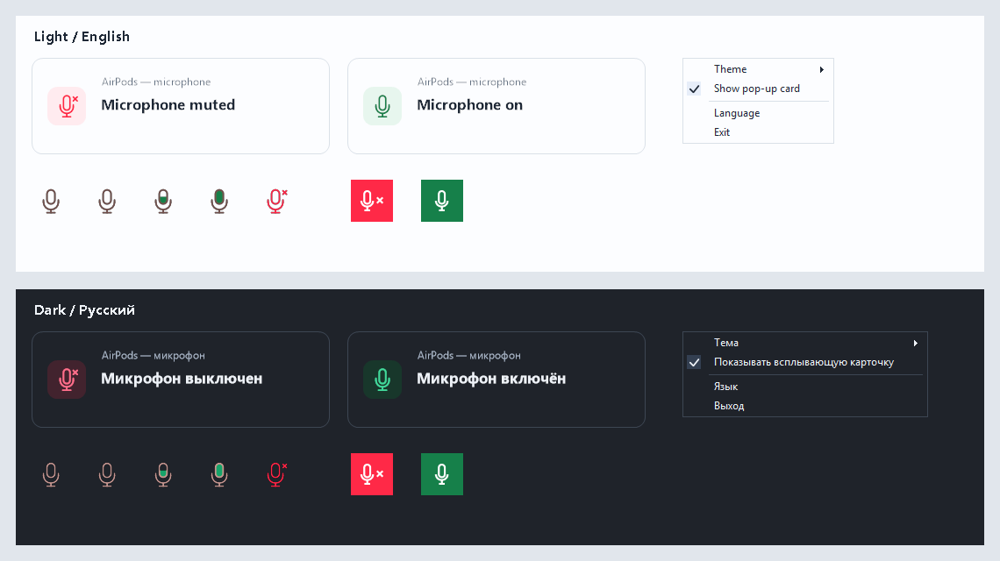

# AirPods Mic Bridge

Windows tray utility that turns the AirPods play/pause gesture into a system microphone mute toggle while an application actively uses the AirPods microphone. Voice applications and microphone-enabled browser sites follow the same rule.

[Русская документация](README.ru.md) · [Download releases](https://github.com/goodserg/AirPodsMicBridge/releases) · [Changes](CHANGELOG.md)

## Use

1. On Windows 11 x64, download and run `AirPodsMicBridge-1.3.0-Setup.exe` from the release. First choose **Current user** (default, no administrator privileges) or **All users** (requires administrator privileges), then choose the installation folder. The final **Launch AirPods Mic Bridge** and **Start with Windows** checkboxes are checked by default. .NET Framework 4.x is required.
2. Connect AirPods, select their microphone in your voice application or browser site, and start microphone use.
3. Press the AirPods stem once to mute; press again to unmute. The gesture must arrive in Windows as a play/pause command.

The installer supports the same six languages as the application and creates a Start menu shortcut. For portable use, download the release ZIP, extract it and run `AirPodsMicBridge.exe`. The ZIP does not create startup automatically; an existing startup registration can still be active. Use **Start with Windows** in the tray menu to change startup for your account.

The tray microphone has a transparent background. Its capsule fills with the current microphone signal level; no audio is recorded. Red with an X means muted, an outline means enabled, and grey means unavailable or control paused.

A red **48×48 physical pixel** indicator stays at the top-left corner of the primary screen while the observed AirPods microphone is muted. After unmuting, a green indicator appears for 2.2 seconds. Indicators pass clicks through and do not take focus.

Right-click the tray icon to choose:

- Microphone control on/off.
- Start with Windows on/off.
- Optional notification card, **off by default**.
- Theme: **Automatic (Windows)**, Light, Dark.
- Language: **Automatic (Windows)**, Русский, English, Español, Português (Brasil), Português, Bahasa Indonesia.
- Headset diagnostics.
- Exit.

Automatic language follows the Windows UI language, using English for unsupported languages. Region-specific Brazilian Portuguese takes precedence over Portuguese. Changes apply immediately and are saved. Automatic menu/card theme follows the Windows app theme; tray contrast follows the Windows taskbar theme even when they differ. Windows theme changes are checked once per second. The red/green corner indicator retains its fixed state colours.



Appearance examples; the optional card is enabled for this preview.

## Behaviour and compatibility

- Mute affects the selected Windows recording device and every application using it. An application's own mute control may display a different state. System mute does not enable a disabled browser microphone track or change a site's mute button.
- Control is armed while one unambiguous AirPods device has an active Windows capture session. This includes browser capture and system sessions; there is no application-name, window or website allowlist. A microphone test can also activate control, so an active session does not prove a call is connected. Another microphone is never selected as a fallback.
- All Windows play/pause commands are eligible while control is armed, including commands from another keyboard, headset or app. Outside this condition, media playback works normally. A recent cached state can suppress one command immediately after microphone use ends; the worker rechecks and cancels that toggle.
- Ambiguous active AirPods devices, unknown session states or AirPods discovery errors keep control disarmed.
- An application's mute button may keep its capture session open or release it. If no active session remains, gestures do not toggle the microphone. Re-enable microphone use in the application first, then use AirPods for system mute.
- The muted corner indicator also follows external mute changes outside active microphone use, whenever one connected AirPods microphone can be identified.
- Exiting or updating the utility preserves the microphone's current mute state. Automatic startup can be changed from the tray menu.

The tested hardware setup used AirPods 4 with the **MagicAAP driver enabled**. The utility calls standard Windows APIs and does not call that driver directly. Operation without the driver depends on the Bluetooth path delivering a detectable play/pause command during microphone use; that case has **not** been verified. Application-independent detection does not mean every application or Bluetooth driver has been physically tested. The utility does not modify applications or Bluetooth drivers.

Detection uses standard Windows audio sessions. Exclusive-mode or ASIO capture paths are not verified and may require device hardware mute; software endpoint mute does not guarantee control of those paths.

## Settings and diagnostics

Preferences: `%LOCALAPPDATA%\AirPodsMicBridge\settings.json`.

The default installation folder is `%LOCALAPPDATA%\Programs\AirPodsMicBridge` for the current user or `%ProgramFiles%\AirPodsMicBridge` for all users. The folder page lets you change it. Preferences and diagnostics stay in each user's own app-data directory. Uninstalling removes program files and the installation's startup shortcut while preserving user data.

**Start with Windows** uses an application-owned shortcut with the `--autostart` argument. A current-user installation uses `%APPDATA%\Microsoft\Windows\Start Menu\Programs\Startup`; an all-users installation uses the common Startup folder, `%PROGRAMDATA%\Microsoft\Windows\Start Menu\Programs\Startup`. The tray option controls startup for the current account. Turning it off with a common shortcut present saves a per-user opt-out marker without administrator privileges; the common shortcut remains for other users. Turning it back on clears that marker.

For unattended installation, use `/VERYSILENT /SUPPRESSMSGBOXES /NORESTART` with `/CURRENTUSER` or `/ALLUSERS` to select scope. All-users installation requires elevation. Startup is enabled by default; `/STARTUP=no` disables it, including during an upgrade. `/LANG=en|ru|es|ptBR|pt|id` selects the installer language; `ptBR` means Brazilian Portuguese. The application's language continues to follow Windows unless selected manually in its menu. To manage the common startup shortcut directly, run `AirPodsMicBridge.exe --startup-enable-all-users` or `--startup-disable-all-users` from an elevated command prompt.

Local diagnostic logs: `%LOCALAPPDATA%\AirPodsMicBridge\logs`. They contain audio-device names, identifiers and state changes, but no recordings, signal-level history or arbitrary keyboard input. No data is uploaded. `AIRPODS_MIC_BRIDGE_DATA` can override the whole data directory for development/testing.

Stop a running copy:

```powershell
.\AirPodsMicBridge.exe --stop
```

## Headset diagnostics

Open **Headset diagnostics** from the tray menu, or run `AirPodsMicBridge.exe --diagnostics`. Select the microphone you want to investigate; other headset brands can also be tested.

The wizard follows the selected theme and language. The theme covers its title bar, microphone selector, progress track and buttons, including disabled states.

1. Start a call or microphone test in another application, then click **Start**.
2. Press the headset button once at each of the six prompts, five seconds apart. The test stops after 30 seconds; **Stop** ends it earlier.
3. Click **Save report…** and choose a destination for the JSONL file.

The bridge pauses microphone control during the test. The headset and other applications can still perform their own button actions. Reports contain timestamps, Windows media commands such as Play/Pause, Stop and volume, available consumer/telephony HID reports, microphone mute/capture-state changes, and installed audio/Bluetooth/HID driver names, versions and INF identifiers. MagicAAP is also included when registered under another device class. They contain no audio, signal-level history or ordinary keyboard input.

Original reports stay under `%LOCALAPPDATA%\AirPodsMicBridge\diagnostics`; saving makes a copy at your chosen path. Device names and identifiers may include a personally assigned headset name or Bluetooth address. Nothing is uploaded automatically, and personal reports are not release assets.

This records what Windows exposes to applications. It does not sniff Bluetooth protocol packets or reveal commands a closed driver keeps internally. A listed driver does not prove it emitted a recorded event. Diagnostics can help investigate support for another headset; microphone control still targets AirPods.

## Build and checks

```powershell
.\build.ps1
.\test.ps1
.\build-installer.ps1 -CompilerPath 'C:\Program Files (x86)\Inno Setup 6\ISCC.exe'
.\package.ps1
```

The application build uses the Windows .NET Framework C# compiler (C# 5, x64), without external packages or network downloads. Building the installer additionally requires Inno Setup 6.7.3; its Indonesian language file is included with source attribution. Default output is `dist\AirPodsMicBridge`. Temporary build files use the operating system's temporary directory; `-BuildRoot` overrides it. Tests run without microphone changes or recording, and startup checks use isolated per-user and common Startup directories. Build the installer before packaging; packaging creates the ZIP and SHA-256 manifests under `dist` and includes the setup executable in the release checksums.

`test-installer.ps1 -CompilerPath <ISCC.exe>` builds an isolated fixture and checks installation, upgrades and uninstallation in all six languages. It creates temporary program/shortcut/data directories and a separate per-user uninstall entry, then removes the fixture installation. Common-startup behaviour uses a separate test directory. These checks do not install the production all-users package or change the real Startup folders and running application.

The system DPI-aware manifest prevents Windows from enlarging the 48×48 corner indicator on the primary monitor. See [architecture](docs/architecture.md) for threading and device-selection rules.

This repository is public for viewing and downloading. Direct write access is limited to its owner and explicitly authorised maintainers; no additional collaborators are granted access by publication. The corner microphone drawing was supplied as a UI reference and reproduced for this utility. This project is independent of Apple and Bluetooth driver vendors.
